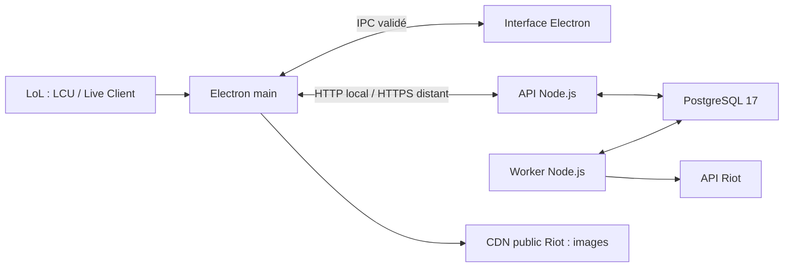

# Architecture actuelle

Décision du 25 octobre 2026 : Electron et TypeScript pour réduire la maintenance entre le bureau et les services. Le serveur reste séparé, utilisable sur le PC puis sur un hébergement distant. Ce choix remplace la décision WPF/.NET de septembre ; il n’est pas présenté comme un gain de performances mesuré.

## Responsabilités

| Composant | Emplacement | Responsabilité |
|---|---|---|
| Processus principal Electron | `apps/desktop/main.ts` | Fenêtres, raccourci, appels serveur, stockage sécurisé, surveillance locale LoL |
| Preload et contrats | `apps/desktop/preload.ts`, `contracts.ts` | IPC étroit et validé, sans exposer Node au renderer |
| Interface | `apps/desktop/renderer.ts`, `ui/` | Profil, détails, draft, overlay et calculs de l’échantillon visible |
| Cache et images | `cache.ts`, `public-assets.ts` | Propriétaire hors ligne, profils récents, images publiques Riot en cache |
| API privée | `apps/server/api.ts` | Authentification par clé, lectures de profils et demandes de collecte |
| Worker | `apps/server/worker.ts`, `riot.ts` | Identités/rangs Riot, matchs manquants, reprise et gestion des erreurs |
| Stockage | `apps/server/store.ts` | File durable, ingestion dédupliquée, agrégats, quotas PostgreSQL |
| Domaine partagé | `packages/core/index.ts` | Modèles, parsing Riot, calculs et règles de modes/rôles |

Le client calcule le bilan des parties affichées. Les agrégats de saison sont calculés et stockés côté serveur. Le serveur n’a pas accès au lockfile LoL ni aux secrets LCU du PC.

## Contrats et cycle de lecture

Le profil en cache est affiché immédiatement, puis une recherche serveur est lancée au démarrage lorsque l’accès est configuré. La recherche publie progressivement les données disponibles. Le client consulte la version du profil toutes les quinze secondes lorsqu’il est sur cet écran ; pendant une recherche, un suivi plus rapproché est borné. Il ne dépend pas de SignalR dans ce parcours.

La pagination lit dix lignes en base avec une borne de fin fixe. Les mises à jour relisent la fenêtre déjà ouverte au lieu de la réduire à la première page. Les recherches ne changent pas le propriétaire personnel détecté par LoL. Les identités masquées et bots ne sont pas transformés en cibles de recherche.

## Persistance et compatibilité

- PostgreSQL v2 : matchs, contributions, agrégats, jobs, curseurs, délais et réservations de quota. Le format JSON PascalCase historique reste compatible.
- Electron : données sous `%APPDATA%\rift-companion`, cache borné et clé d’accès chiffrée par le système, liée à l’origine du serveur.
- WPF : import en lecture seule du fichier de profil personnel ; préférences SQLite non importées automatiquement.
- Assets : les illustrations et catalogues de `native/Rift.Desktop/Assets` sont encore copiés au build. Les notices `SOURCE.md` restent nécessaires.
- Schéma : `server/Rift.Backend/schema.sql` reste la source partagée du schéma SQL.

Le parcours Node ne nécessite aucun processus .NET. Les sources C# et leurs contrôles sont conservés pour comparaison et retour arrière, pas comme une deuxième implémentation à enrichir en parallèle.

## Accès et distribution

Le renderer est isolé, sans intégration Node, et ne reçoit pas la clé d’accès. Les requêtes passent par les méthodes IPC validées. La clé Riot est conservée côté worker. Les images publiques sont téléchargées depuis un hôte fixe sans identifiants serveur.

Le déploiement actuel est privé, avec une clé partagée et des budgets globaux. Avant une ouverture publique : comptes/sessions, quotas par utilisateur, observabilité, sauvegardes/restauration, stratégie de migrations, compatibilité API, signature et mises à jour du client. Le produit et l’usage des données doivent être conformes aux conditions Riot ; la clé de développement n’est pas une autorisation de production publique.

## Limites de la migration

- L’overlay standard Electron ne couvre pas le plein écran exclusif.
- Placement/focus multi-écran et DPI à qualifier ; mesures en jeu encore absentes.
- Diagnostic Electron limité à l’état de connexion, à la version et à la configuration ; le diagnostic détaillé WPF n’est pas porté.
- Méthodes synchrones `safeStorage` dépréciées par Electron 45 : adaptation asynchrone prévue, pas encore livrée.
- OP.GG, rang mondial, recommandations de draft et comparaison d’équipement live ne sont pas intégrés dans le parcours actuel.

Versions exactes : [package.json](../package.json) et [package-lock.json](../package-lock.json). Prochaines étapes : [feuille de route](ROADMAP.md).
