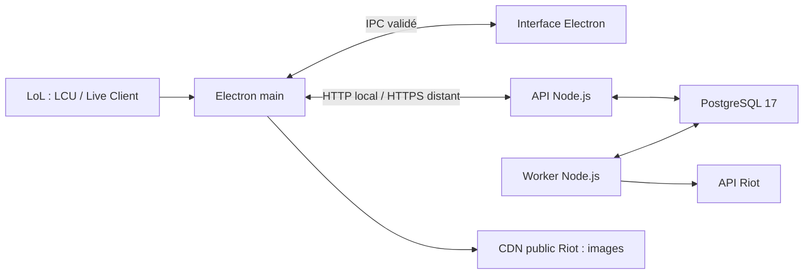

# Architecture actuelle

Décision du 25 octobre 2026 : Electron et TypeScript pour réduire la maintenance entre le bureau et les services. Le serveur reste séparé, utilisable sur le PC puis sur un hébergement distant. Ce choix remplace la décision WPF/.NET de septembre ; il n’est pas présenté comme un gain de performances mesuré.

## Responsabilités

| Composant | Emplacement | Responsabilité |
|---|---|---|
| Processus principal Electron | `apps/desktop/main.ts` | Fenêtres, raccourci, appels serveur, stockage sécurisé, surveillance locale LoL |
| Preload et contrats | `apps/desktop/preload.ts`, `contracts.ts` | IPC étroit et validé, sans exposer Node au renderer |
| Interface | `apps/desktop/renderer.ts`, `ui/` | Profil, détails, draft, overlay et bilan des 20 premières parties du filtre |
| Cache et images | `cache.ts`, `public-assets.ts` | Propriétaire hors ligne, profils récents, images publiques Riot en cache |
| API privée | `apps/server/api.ts` | Authentification par clé, lectures de profils et demandes de collecte |
| Worker | `apps/server/worker.ts`, `riot.ts`, `sync.ts` | Identités/rangs Riot, matchs manquants, reprise et gestion des erreurs |
| Stockage | `apps/server/store.ts` | File durable, ingestion dédupliquée, agrégats, quotas PostgreSQL |
| Domaine partagé | `packages/core/index.ts` | Modèles, parsing Riot, calculs et règles de modes/rôles |

Le client calcule le bilan d’un échantillon de vingt parties fourni indépendamment de la pagination. Les agrégats de saison sont calculés et stockés côté serveur. Le serveur n’a pas accès au lockfile LoL ni aux secrets LCU du PC.

## Contrats et cycle de lecture

Le profil en cache est affiché immédiatement, puis une recherche serveur est lancée au démarrage lorsque l’accès est configuré. Le client suit le profil toutes les cinq secondes lorsqu’il est affiché et reprend automatiquement une page en attente ; aucun nombre maximal d’essais ne termine arbitrairement une collecte. Les erreurs de source conservent les données visibles.

`GET /v1/players/:platform/:puuid/history?queue=0&start=0` ouvre ou réutilise une session partagée. La réponse fournit `historySession`, `nextStart`, `hasMore`, `historyState`, `historyRetryAt` et `overviewMatches`. Les appels suivants conservent la session. Le curseur désigne une position persistante dans la liste d’identifiants Riot, y compris les détails indisponibles. Le serveur refuse un saut au-delà des positions traitées. L’ancien endpoint `/profile` reste une lecture compatible des données stockées.

Le worker enregistre une page d’identifiants puis traite un seul détail par tour. Les matchs sont partagés entre tous leurs participants. Les demandes visibles passent avant l’anticipation ; les sessions de même priorité tournent à tour de rôle. Des tours restent réservés aux identités et au récent. Le verrou PostgreSQL commun empêche deux workers de télécharger simultanément le même détail. Un redémarrage reprend les entrées persistées ; les quotas et les délais Riot restent partagés.

Le défilement près du bas ou « Voir plus » augmente la demande de dix positions. Le serveur prépare jusqu’à trente positions au-delà du curseur demandé, par pages source de vingt : au plus une page source supplémentaire peut être terminée. La préparation se ralentit naturellement derrière les demandes visibles. Les lignes déjà ouvertes ne sont pas relues en boucle ; leur position est conservée et le DOM est virtualisé au-delà de cinquante parties. Le cache disque reste borné.

Une session fixe son instant de lecture. Un profil encore sur sa première page peut obtenir un nouvel instant après cinq minutes ou lorsqu’une partie plus récente est enregistrée ; une liste étendue conserve son instant jusqu’à une nouvelle recherche/actualisation. Les recherches ne remplacent pas le propriétaire personnel détecté par LoL. Les identités masquées et bots ne sont pas ciblés.

## Persistance et compatibilité

- PostgreSQL v2 : matchs, contributions, agrégats, jobs, curseurs, délais et réservations de quota. Le format JSON PascalCase historique reste compatible.
- Electron : données sous `%APPDATA%\rift-companion`, cache borné et clé d’accès chiffrée par le système, liée à l’origine du serveur.
- WPF : import en lecture seule du fichier de profil personnel ; préférences SQLite non importées automatiquement.
- Assets : les illustrations et catalogues de `native/Rift.Desktop/Assets` sont encore copiés au build. Les notices `SOURCE.md` restent nécessaires.
- Schéma de base : `server/Rift.Backend/schema.sql` en v2. Extension additive TypeScript dans `apps/server/sync.ts` : sessions, index de matchs et lots du collecteur. Aucun effacement des données existantes. Les anciens services ignorent cette extension ; ne pas exécuter leurs workers simultanément.

Le parcours Node ne nécessite aucun processus .NET. Les sources C# et leurs contrôles sont conservés pour comparaison et retour arrière, pas comme une deuxième implémentation à enrichir en parallèle.

## Accès et distribution

Le renderer est isolé, sans intégration Node, et ne reçoit pas la clé d’accès. Les requêtes passent par les méthodes IPC validées. La clé Riot est conservée côté worker. Les images publiques sont téléchargées depuis un hôte fixe sans identifiants serveur.

Le déploiement actuel est privé, avec une clé partagée et une admission globale du travail. L’admission borne à 1 000 les nouvelles identités en attente et à 1 000 les sessions actives ayant du travail restant ; 64 requêtes authentifiées simultanées au maximum sont traitées par processus API. Ce sont des seuils de protection, pas une capacité mesurée. Avant une ouverture publique : comptes/sessions, équité et budgets par utilisateur, tests de charge, observabilité, sauvegardes/restauration, stratégie de migrations, compatibilité API, signature et mises à jour du client. Le produit et l’usage des données doivent être conformes aux conditions Riot ; la clé de développement n’est pas une autorisation de production publique.

## Limites de la migration

- L’overlay Electron cible uniquement les modes sans bordure et fenêtré. Le plein écran exclusif est abandonné (décision du 27/10/2026) ; les essais natifs restent archivés hors du build et du paquet distribués.
- Placement/focus multi-écran et DPI à qualifier ; mesures en jeu encore absentes.
- Diagnostic Electron limité à l’état de connexion, à la version et à la configuration ; le diagnostic détaillé WPF n’est pas porté.
- Méthodes synchrones `safeStorage` dépréciées par Electron 45 : adaptation asynchrone prévue, pas encore livrée.
- OP.GG, rang mondial, recommandations de draft et comparaison d’équipement live ne sont pas intégrés dans le parcours actuel.

Versions exactes : [package.json](../package.json) et [package-lock.json](../package-lock.json). Prochaines étapes : [feuille de route](ROADMAP.md).
